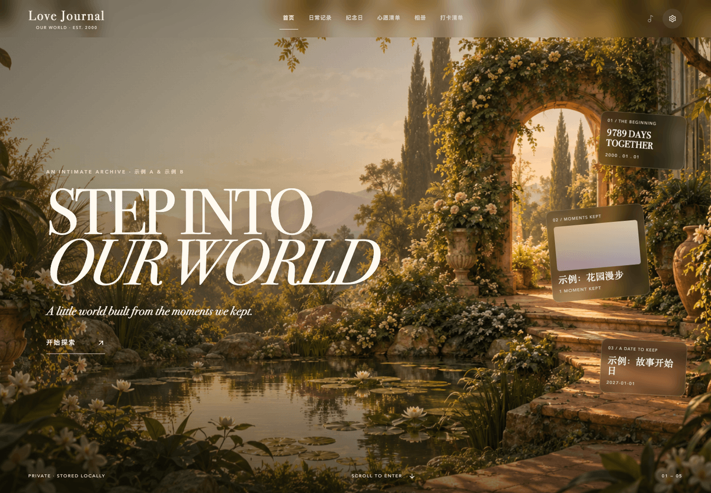
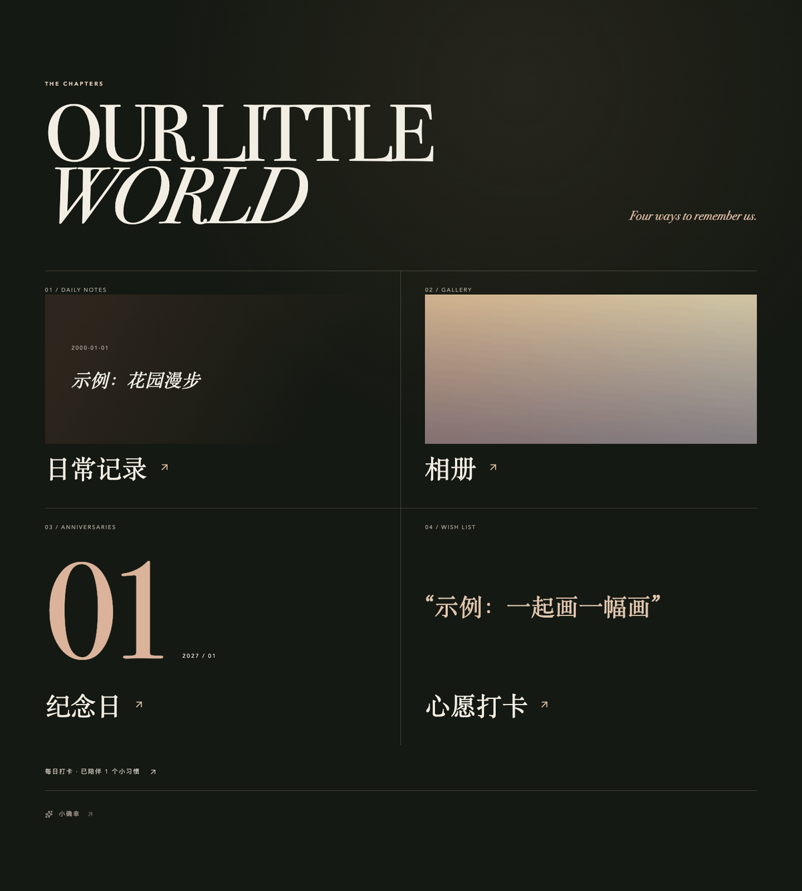
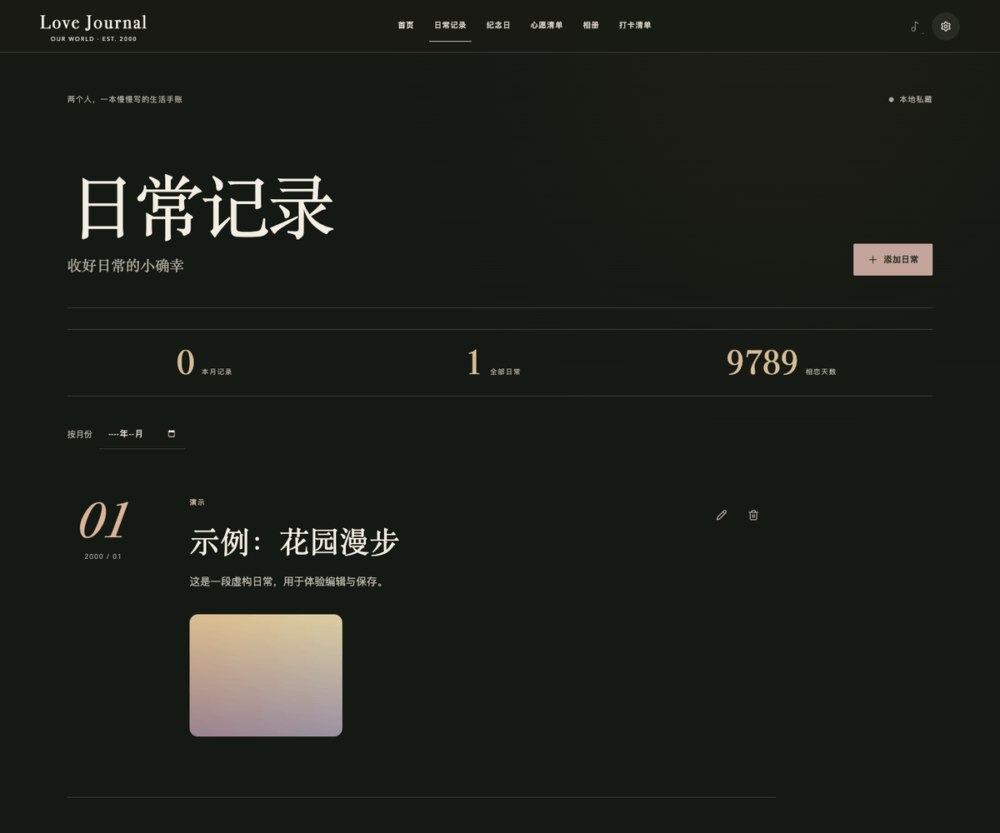
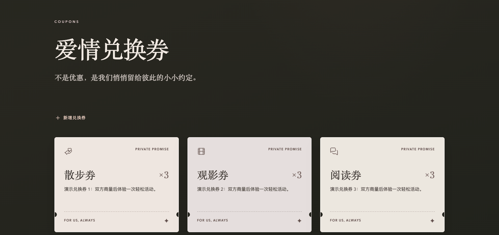

# Love Journal

### 给两个人的回忆，留一个可以走进去的地方。

*A little place for everything we don't want to forget.*

一款融合**沉浸式视觉体验与日常记录**的情侣回忆网站。从植物环绕的入口出发，慢慢翻看日常、照片和重要的日子，也为彼此留下一些轻松的小约定。

**[本地体验 →](#try-it-yourself--亲自走进去)** · 无需注册 · 浏览器本地保存 · 虚构演示数据



公开仓库为脱敏演示版，不含作者私人记录。当前未提供经验证的公开在线演示地址。

## The Idea · 如果回忆也有一个入口

照片可以放进相册，纪念日可以写进日历。但如果把两个人的日常放在同一个地方，让重新浏览这些片段本身也成为一种体验呢？

Love Journal 围绕这个想法展开：先用植物、光线与层次建立一个空间，再把记录整理成可以进入的章节。记下一天、翻看影像、兑换一次散步，都发生在同一个小世界里。

这是一份个人产品实践：把生活中的记录需求，做成具有氛围、也能实际编辑和保存内容的 Web 产品。

## The Experience · 慢慢进入，随时记录

以下截图均来自**当前公开演示版的真实运行界面**，在全新隔离浏览器中拍摄。示例 A / 示例 B、日期、文字和兑换券均为虚构；相片位置使用程序生成的抽象色块，植物背景为公开版重新生成的 AI 图片。它们不代表真实人物、地点或私人回忆。

### 01 — Enter the Memories

首页先给出一个可以走近的场景。滚动或点击「开始探索」，植物前景与背景随进度变化，文字和悬浮记忆逐渐退场，随后进入日常、相册、纪念日与心愿章节。入口希望给浏览留一点节奏，让打开回忆的过程也有场景感。



### 02 — Keep the Moments

用日期、文字和影像保存一个日常片段，之后按月份重新翻找。日常中的照片与视频也会出现在相册，重要日期则可以单独设为纪念日。浏览与整理连接起来，让一段记录能被再次找到。



### 03 — Little Things Between Us

「小确幸」里，留言像纸片一样被翻阅，爱情兑换券把散步、观影等小约定做成可使用的票根。选择一张、确认兑换，剩余数量随之更新并保存在本地。除了回看过去，也为下一次共同活动留一点期待。



兑换券是本地趣味互动，不涉及支付、自动通知或服务履约，也不会同步到另一台设备。

## Design Thinking · 三个设计判断

### 先进入空间，再选择章节

首页把主要篇幅留给植物场景与记忆入口，章节导航放在进入之后；顶部导航仍可直接到达内容页。这样既保留沉浸式浏览的节奏，也给想立即记录的人一条更短的路径。

### 用层次表达氛围，让动效有去向

前景植物、背景景深和悬浮卡片以不同方式随滚动移动，最终将视线交给章节内容，而不是停在一段装饰动画上。实现也尊重系统的减少动态效果偏好：开启时跳过入口镜头推进，直接到达章节。

### 平时翻阅，需要时再整理

小确幸页面优先展示留言和票根，编辑、置顶、隐藏及数量管理放进独立侧栏或弹窗。把管理操作从日常翻阅中收起来，同时保留修改内容、确认兑换与保存状态的完整路径。

## How It Works · 从场景到记录

**进入场景 → 打开章节 → 编辑与保存 → 再次翻阅**

React 与 TypeScript 承载页面和数据交互，Vinext / Vite 负责运行与构建。植物场景使用 CSS 图层和由滚动进度驱动的变换；页面切换、卡片入场、弹窗与声音反馈共同衔接浏览和操作。

主手账写入 IndexedDB，照片在浏览器内处理，视频以 Blob 单独保存；留言和兑换券使用独立的 localStorage。主手账支持 JSON 导入导出与覆盖前确认，因此页面中的内容可以修改并在刷新后保留，并非仅供观看的静态画面。

## Try It Yourself · 亲自走进去

当前未提供经验证的公开在线体验地址。可在本机运行公开演示版，无需 API Key、数据库或后端配置。

需要 Node.js **22.13+** 与 pnpm **11.25.0**（可用 `npm install -g pnpm@11.25.0` 安装）。

```sh
git clone https://github.com/Cocobolo111-png/love-journal.git
cd love-journal
pnpm install --frozen-lockfile
pnpm dev
```

打开 **http://localhost:4180/**。建议先点击「开始探索」，进入「日常记录」编辑一条虚构记录，再从首页的「小确幸」试用一张演示兑换券。

首次在当前地址打开时，会展示虚构人物、固定演示日期、示例记录、抽象色块相片、留言和兑换券。可以编辑、删除或添加内容，刷新后编辑仍保留；示例初始化不会覆盖已有的当前演示版数据。声音在浏览器允许且发生用户交互后播放，可手动静音。

**数据只保存在当前浏览器和站点，没有双人云同步。** 更换设备、浏览器、域名、端口，或在 `localhost` 与 `127.0.0.1` 之间切换，都不会自动带上原有数据。清理站点数据或浏览器回收存储可能导致记录丢失。

在「我们的设置」中可导出主手账 JSON，包含记录、照片与视频。**此导出不包含「小确幸」独立保存的留言与兑换券，也不包含声音偏好；它不是全站备份。** 导入会在确认后替换当前主手账。请将私人备份保存在仓库之外，不要上传至公开仓库。

## For Developers · 开发与开源说明

### 本地安装与技术栈

安装步骤见[本地体验](#try-it-yourself--亲自走进去)。`.env.example` 说明了配置边界，无需复制即可运行。

主要技术为 React 19、TypeScript、Vinext / Vite、Tailwind CSS、Base UI / shadcn 与 Lucide。Cloudflare Vite 插件及 Wrangler 用于开发、构建和本地预览；当前应用没有用户登录、服务端数据库、媒体上传接口或共享数据 API。

### 项目结构

```text
app/                    首页、小确幸页面与视觉样式
components/             UI 组件、全局声音控制
hooks/                  响应式辅助逻辑
lib/journal.ts          本地手账、媒体与主手账备份逻辑
lib/little-joys.ts       留言、兑换与独立持久化
lib/demo-data.ts         全部虚构初始内容
lib/audio-system.ts     声音生命周期与效果控制
lib/portal-motion.ts    入口动画曲线
public/                 演示植物背景、图标与合成音频
scripts/                可复现音频生成与发布文件审计
tests/                  数据、兑换、动画与声音逻辑测试
docs/                   安全、资源授权说明与 README 截图
```

### 数据存储与备份范围

| 内容 | 保存位置 | 主手账 JSON 是否包含 |
| --- | --- | --- |
| 人物设置、日常、纪念日、心愿、打卡、照片与视频 | IndexedDB | 包含 |
| 小确幸留言、置顶 / 隐藏状态、兑换券与剩余数量 | 独立 localStorage | **不包含** |
| 声音偏好、音乐播放位置 | localStorage / sessionStorage | 不包含 |

演示版使用独立的 `love-journal-demo-*` 存储名称。所有虚构初始内容集中在 [`lib/demo-data.ts`](lib/demo-data.ts)；只在没有当前演示版数据时使用，不读取作者的私人数据。

导入图片会在浏览器重绘为最长边 1800px 的 JPEG；视频保留原始 Blob，可能包含原文件元数据，不适合直接公开。选择本地媒体只写入当前浏览器，不上传到服务端。

图片上限 20MB，视频上限 100MB，每条记录最多 12 项影像，主手账备份上限 500MB。MOV 播放依赖浏览器编码支持，可先转为 H.264 MP4。大量视频会占用本地存储，导出文件也可能较大；不要将主手账导出视为小确幸的数据恢复方案。

### 测试与构建

```sh
pnpm test
pnpm typecheck
pnpm lint
pnpm build
pnpm start
```

`pnpm start` 使用 Wrangler **在本地预览构建结果**，请访问终端显示的地址；此命令不会发布网站。Vinext 当前为 beta，升级后需重新检查构建和交互。

测试覆盖手账与媒体备份校验、演示数据、兑换券持久化、入口运动曲线和声音生命周期。实际音频播放与视频格式兼容性仍受设备、浏览器及其权限限制。

### 许可与素材来源

源码采用 [MIT](LICENSE)。依赖与 UI 派生组件遵循各自许可证，见[第三方声明](THIRD_PARTY_NOTICES.md)。演示植物背景是为本项目重新生成的 AI 图片；色块、图标与合成音频为新创作素材，不包含私人照片、录音或来源不明的原项目媒体，详见[资源清单](docs/ASSETS.md)。AI 输出不承诺独占版权，应遵循适用法律与生成服务条款。

`docs/images/` 中的四张 README 截图取自本公开仓库的运行界面，仅使用仓库内已有的演示内容与素材，经尺寸优化，不包含私人记录或外部照片。

### 安全注意事项

本地存储不等于多人访问控制。如自行用于公网服务，需另行设计身份验证、访问控制与安全同步；当前版本适合本地体验。不得公开个人备份，也不得将生产凭证写入前端环境变量。

不要将私人项目目录或其 Git 历史合并、推送到此仓库。后续只按文件或补丁移植经审查的源码，保持虚构数据、独立存储名称与演示素材；禁止复制环境文件、部署目录、备份及构建输出。素材来源不明确时排除。

提交前逐项检查 `git diff --cached`，运行现有文件审计、Gitleaks、测试和构建；同时人工检查新增媒体与提交身份。扫描零命中不能代替人工审核。完整流程见[安全说明](docs/SECURITY.md)。报告问题时不要在公开 issue 附上真实备份或凭证。
